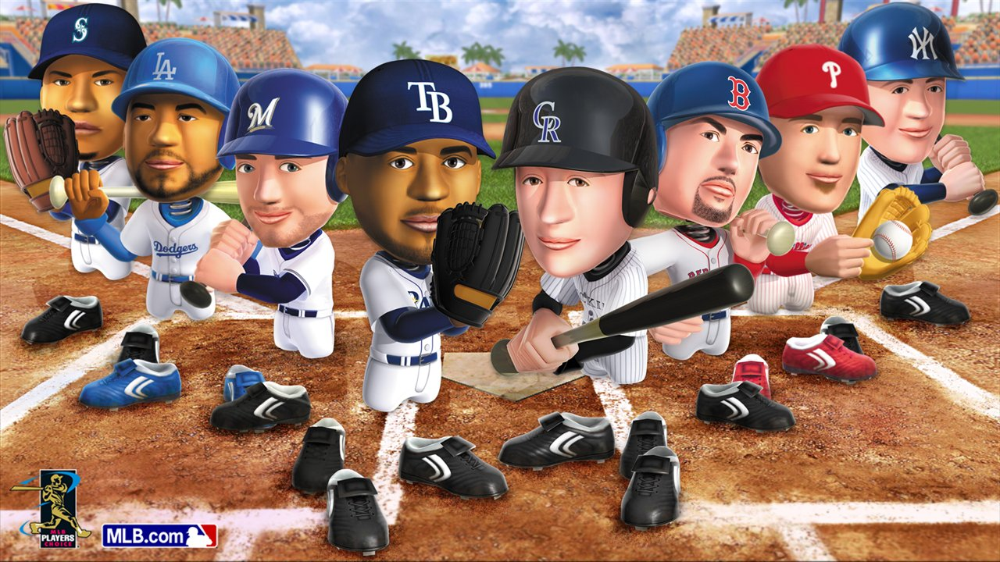
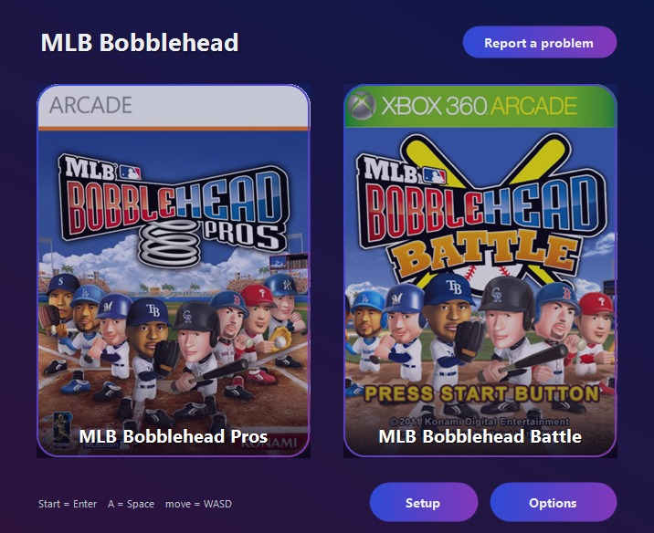
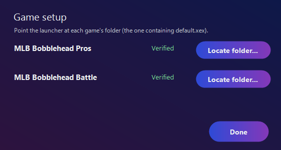

# MLB Bobblehead Recomp

<p align="center">
  <br>
  <sub>Official <i>MLB Bobblehead Pros</i> artwork © 2011 Konami Digital Entertainment. MLB and team marks are the property of their owners.</sub>
</p>

[](https://github.com/Wndwsqrrl/MLBBobble-recomp/releases/tag/v0.1.0)
[](LICENSE)

Native Windows PC ports of the two Xbox 360 **MLB Bobblehead** games, made by **static
recompilation** with [ReXGlue](#acknowledgements): the original PowerPC game code is translated
ahead of time into C++ and compiled into a native x64 program that runs on a Xenia-derived
runtime. No emulator is involved. You supply the game data from your own copy.

| Game | Title ID | Status |
|------|----------|--------|
| **MLB Bobblehead Pros** | `58410B7B` | ▶️ Playable: menus to full matches, full version, keyboard or controller |
| **MLB Bobblehead Battle** | `58410B7C` | ▶️ Playable: menus to full matches · ⚠️ **no audio** ([details](#known-issues)) |

> ⚠️ **v0.1.0 is an early release of the base games** (no roster updates or DLC). Both games
> play full matches, but expect rough edges; see [Known issues](#known-issues).

## Screenshots

<table>
  <tr>
    <td width="57%"></td>
    <td></td>
  </tr>
  <tr>
    <td align="center">The launcher</td>
    <td align="center">Setup checks your game files</td>
  </tr>
</table>

## Contents

- [Screenshots](#screenshots) · [Quick start](#quick-start) · [What's in the download](#whats-in-the-download)
- [Requirements](#requirements) · [Getting your game files](#getting-your-game-files)
- [Controls](#controls) · [Launcher](#launcher) · [Reporting issues](#reporting-issues)
- [Building from source](#building-from-source)
- [Known issues](#known-issues) · [Repository layout](#repository-layout)
- [Acknowledgements](#acknowledgements) · [Legal](#legal)

---

## Quick start

1. **Get your game files.** Extract your own Xbox 360 copy of each game (see
   [Getting your game files](#getting-your-game-files)).
2. **Download** `MLB-Bobblehead-Recomp-0.1.0-setup.exe` (or the portable zip) from
   [Releases](https://github.com/Wndwsqrrl/MLBBobble-recomp/releases) and install it.
3. **Start MLB Bobblehead Pros or Battle** from the Start menu. The first time, the launcher's
   Setup screen asks you to locate each game's folder (the one containing `default.xex`) and
   checks that it is the version these builds were made from (it shows **Verified**).
4. Play.

## What's in the download

- **Included:** the launcher, both games' recompiled executables (`bobbleheadpros.exe`,
  `bobbleheadbattle.exe`) with the ReXGlue runtime (`rexruntime.dll`, `rexgpu-xenos.dll`) and
  their settings files, app icons and the launcher's box art.
- **Not included:** any game data. Models, textures, stadiums, audio, rosters and everything
  else the games load come from your own copy. The executables do nothing without it.

## Requirements

- Windows 10 or 11, 64-bit
- A Direct3D 12 GPU
  - **NVIDIA:** the default render path shows a black screen; the included settings already
    select the ROV path (`render_target_path_d3d12 = "rov"`). Leave it as it is.
  - **Laptops with two GPUs:** the games pick the high-performance (discrete) GPU
    automatically. To force a particular adapter, set `d3d12_adapter` (0-based) in the game's
    `.toml`.
- Your own extracted game files (below)

## Getting your game files

Each game is an Xbox Live Arcade package (STFS/CON). Extract it with any STFS extractor so you
end up with the game's `default.xex` and its `data\` folder:

```
<your game folder>\
 ├─ default.xex
 └─ data\xbox360_us\...     (models, textures, sound, ...)
```

These builds were recompiled from the **World** XBLA release of each game. The launcher checks
your `default.xex` against that version when you locate a folder; another version or a
modified file may not work (you can still choose to use it).

## Controls

A standard XInput controller works. With keyboard mode on (`mnk_mode = true`, the default), the
Xbox pad maps to the keyboard. Menu inputs sometimes need a firm, slightly longer press.

| Xbox pad | Keyboard |
|----------|----------|
| Start | Enter |
| A | Space |
| B | Backspace |
| X | L |
| Y | P |
| Left stick / move | W A S D |
| D-pad | Shift + arrow keys |
| Back | Z or Tab |

## Launcher

The launcher (`MLB Bobblehead Launcher.exe`) ties both games together:

- **Game cards** with box art, greyed out until a game is set up. The Start menu shortcuts
  run `--play pros` / `--play battle`, which start that game directly once it is set up.
- **Setup:** locate each game's folder, with the version check described above.
- **Options:** V-Sync, keyboard controls, fullscreen and resolution (720p, 1080p, 1440p or 4K;
  a preset above your screen's resolution renders higher and scales down for a sharper image).
  The options are written into each game's `.toml`.

It remembers your game folders in `launcher.cfg` next to the launcher.

## Reporting issues

Found a crash, a freeze, a graphics problem or anything else that seems wrong? Please report
it on the [Issues page](https://github.com/Wndwsqrrl/MLBBobble-recomp/issues). Check the
[Known issues](#known-issues) first; those are already being looked at.

1. **Reproduce it if you can**, then close the game.
2. In the launcher, click **Report a problem**. It saves a zip to your Desktop and opens the
   folder.
3. **Open a new issue** and include:
   - which game (Pros or Battle),
   - what you were doing when it happened (menu, game mode, inning, stadium...),
   - what you expected and what happened instead (a screenshot or short clip helps),
   - whether it happens every time,
   - the report zip, attached to the issue.

**What the report contains:** your most recent game logs and the launcher's log, a short system
summary (Windows version, CPU, RAM, GPU and driver, and whether your `default.xex` matched the
expected version) and both games' settings files. Your Windows user name is removed from
everything in it, and it contains no game files or saves. Please don't attach game files to an
issue.

The logs themselves are in `Documents\bobbleheadpros\logs\`: one file per game session (the
last 10 per game are kept) and `launcher.log`.

## Building from source

You need:

- The [ReXGlue SDK](#acknowledgements) v0.10.0 (commit `c94f5eb`) with this project's patch
  applied: `sdk-patches/rexglue-sdk-local.patch` (see [`sdk-patches/`](sdk-patches/)). Build
  and install it.
- Visual Studio 2022 or newer with Clang/LLVM, CMake and Ninja
- Your own `default.xex` for each game, placed at `pros\game\extracted\default.xex` and
  `battle\game\extracted\default.xex` (these folders are git-ignored)

From a Visual Studio developer shell:

```powershell
cd pros
cmake --preset win-amd64-release
cmake --build --preset win-amd64-release
cd ..\battle
cmake --preset win-amd64-release
cmake --build --preset win-amd64-release
```

The first build step recompiles the game code (PowerPC to C++) into `generated\`, which is
never committed. Each build produces `bobblehead<pros|battle>.exe` with `rexruntime.dll`,
`rexgpu-xenos.dll` and the `.toml` in `out\build\win-amd64-release\`. To run a build directly,
pass the game folder (the engine reads it before the `.toml`):

```powershell
bobbleheadpros.exe   --game_data_root="D:\path\to\MLB Bobblehead Pros (World) (XBLA)"
bobbleheadbattle.exe --game_data_root="D:\path\to\MLB Bobblehead Battle (World) (XBLA)\extracted"
```

**Launcher:** from `launcher\`, with the .NET Framework compiler that comes with Windows
(`%WINDIR%\Microsoft.NET\Framework64\v4.0.30319\csc.exe`):

```powershell
csc -target:winexe -out:"MLB Bobblehead Launcher.exe" -r:System.Windows.Forms.dll -r:System.Drawing.dll `
    -r:System.IO.Compression.dll -r:System.IO.Compression.FileSystem.dll -r:System.Management.dll Launcher.cs
```

**Installer:** with both games and the launcher built and
[Inno Setup 6](https://jrsoftware.org/isinfo.php) installed (`winget install JRSoftware.InnoSetup`):

```powershell
installer\build-installer.ps1 -Version 0.1.0   # setup.exe, portable zip, SHA256SUMS.txt in installer\dist\
```

## Known issues

### Audio

- **Battle has no audio** (no music, sound effects or crowd). The audio is decoded correctly
  but never reaches the final mix: the fault is in Battle's own sound-mixing setup inside the
  recompiled code, which still has to be traced. Battle has audio on real hardware, so this is
  a bug, not intended.
- **Pros audio works** (music, sound effects, commentary).

### Graphics

- **NVIDIA needs the ROV render path** (already set in the included `.toml`; see
  [Requirements](#requirements)). AMD and Intel GPUs have had less testing; if you get a black
  screen, try changing `render_target_path_d3d12`.
- **Crowd lighting can look off** in some stadiums.
- Only the Direct3D 12 backend is built on Windows.

### Online, saves, achievements and DLC

- **No online play.** There are no Xbox Live services behind these ports; the network is
  reported as connected only so the games don't wait for it. Online modes, leaderboards and
  the marketplace don't work.
- **Saves** are written to `Documents\bobbleheadpros\` and have had little testing beyond
  normal play; keep a copy of that folder if your progress matters to you.
- **Achievements:** the Achievements screen opens and closes immediately (it is stubbed to
  avoid a freeze), and nothing is tracked.
- **No updates or DLC in this release.** v0.1.0 plays the base games with their original
  rosters; the Oct 2011 roster update is not supported yet. The Bobblehead Stars DLC doesn't
  load: the game finds the installed package but never opens it, and the check that decides
  this is in the recompiled code and hasn't been found yet.

### Performance

- Higher resolution presets cost performance; if a match stutters, choose a lower one in
  Options. Running with `--log_level=debug` also slows the games down (it writes to disk every
  frame), so use it only for troubleshooting.

## Repository layout

```
pros/            ReXGlue project for MLB Bobblehead Pros (manifest, .toml, src/)
battle/          ReXGlue project for MLB Bobblehead Battle
launcher/        Windows launcher (Launcher.cs) and box art
installer/       Inno Setup script, icons and build-installer.ps1
tools/roster/    Pros roster format research and tools (work in progress, not part of v0.1.0)
sdk-patches/     Patches to the ReXGlue SDK this project needs
```

## Acknowledgements

- **ReXGlue**: the static PowerPC-to-C++ recompiler and runtime this project is built on.
- **[Xenia](https://xenia.jp/)** (Ben Vanik and contributors): the kernel, GPU (Xenos) and XMA
  audio implementations the runtime derives from, under the BSD license.
- **Konami**: the original *MLB Bobblehead Pros* and *MLB Bobblehead Battle* (2011).

## Legal

This is an unofficial fan project for preservation and research. It is **not affiliated with,
endorsed by or sponsored by** Konami, Major League Baseball, MLB Players, Sony Interactive
Entertainment or Microsoft.

The release executables contain program code automatically recompiled from each game's
original `default.xex`. They contain **no game data**: graphics, models, audio, text and
rosters are loaded from the copy you supply, and the executables do nothing without it. To use
this project you need your own legally obtained copy of each game. The source repository
contains no game code or data. If you are a rights holder with a concern, please open an issue.

MLB, team names and logos, player names and likenesses, and the games' titles and box art are
the property of their respective owners.

This project's own code (the recompilation configuration, launcher, installer, roster tools and
SDK patches) is released under the [MIT License](LICENSE). It builds on BSD-licensed code from
Xenia and the ReXGlue runtime, which remain under their own licenses.
